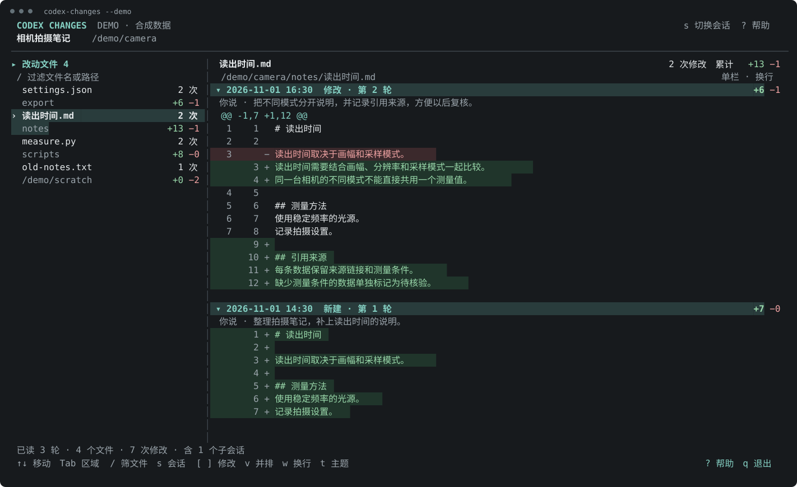

# Codex Changes

在终端里按文件查看 Codex 会话的修改记录。支持非 Git 目录，包括从主目录启动的会话。

选会话，选文件，查看这个文件的历次差异。文件列表汇总整个会话及其子会话中执行成功的修改，不需要逐轮翻聊天记录。



## 安装与启动

需要 Go 1.25 或更新版本，以及支持 `app-server` 的 [Codex CLI](https://github.com/openai/codex)。

```bash
go install github.com/Async23/codex-changes/cmd/codex-changes@latest
codex-changes
```

如果命令不在 `PATH`，可直接运行 `$(go env GOPATH)/bin/codex-changes`。

无需 Codex 或真实历史即可试用界面：

```bash
codex-changes --demo
```

## 使用

- 选择会话后，直接显示文件清单和每个文件的修改次数。
- 点击文件查看时间线；鼠标滚轮滚动所在区域。
- 按 `/` 筛选文件，`s` 切换会话，`Tab` 切换区域。
- 按 `v` 切换单栏与并排，`w` 切换自动换行，`t` 切换主题。
- 按 `?` 查看操作，`q` 退出。

数据来自本机 Codex 的历史接口，不依赖 Git，也不恢复正在运行的会话。统计范围是**历史中已记录且执行成功的文件修改**；通过脚本等方式写入、但未留下修改记录的内容无法还原。增删行数是历次修改的累计值。

## 文档

- [使用说明](docs/usage.md)：完整操作、启动参数、偏好设置与统计范围。
- [开发说明](docs/development.md)：构建、测试、协议边界和贡献方式。

## 许可证

[MIT](LICENSE)。这是独立社区项目，与 OpenAI 无隶属关系。
